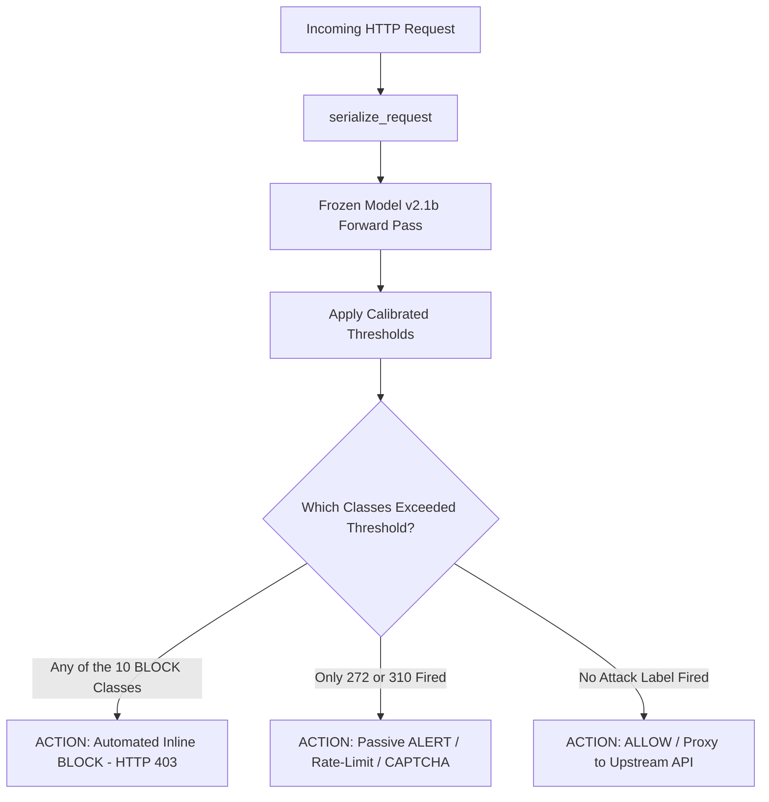
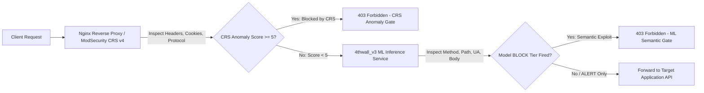

# 4thwall_v3 Migration Guide: Integrating Finalized Frozen Model v2.1b

**Target Audience**: Systems Engineers and ML Builders migrating the finalized multi-label neural WAF into `4thwall_v3`.  
**Model Checkpoint**: Frozen Model v2.1b (`v2_1b_best.pt`)  
**Base Architecture**: `distilbert-base-uncased` Multi-Label Transformer (13 output classes)  
**Evaluation Reference**: [`outputs/final/eval_report.md`](outputs/final/eval_report.md)  
**Canonical Directory**: [`outputs/frozen_v2_1b/`](outputs/frozen_v2_1b/)

---

## 1. Executive Summary & Deliverables Manifest

During the Model v2 $\rightarrow$ v2.1b evaluation and hardening process, the neural WAF was restructured from a vulnerable, leaky baseline into an enterprise-grade, hardened dual-layer inspection system. 

### Mandatory Files for `4thwall_v3` Integration
To migrate this model into `4thwall_v3`, copy the self-contained directory [`outputs/frozen_v2_1b/`](outputs/frozen_v2_1b/) into `4thwall_v3/models/v2_1b/`:

| File Name | Size | Purpose & Role in `4thwall_v3` |
|---|:---:|---|
| **`v2_1b_best.pt`** | 265.5 MB | Optimal Epoch 2 PyTorch checkpoint (strictly frozen; zero fine-tuning). |
| **`thresholds.json`** | 486 B | Validation-calibrated decision thresholds for all 13 output classes. |
| **`metadata.json`** | 890 B | Full architectural configuration, class index mappings, and enforcement tiers. |
| **`scorer.py`** | 4.4 KB | Standalone inference engine with canonical `serialize_request()` and batch scoring. |
| **`README.md`** | 4.8 KB | Operational summary and per-class decision rationale. |
| **`fp_and_swap_diagnostics.json`** | 16.8 KB | Baseline validation metrics and crawler false alarm collapse diagnostics. |

---

## 2. Model Architecture & Specifications

### Backbone & Classification Head
- **Transformer Backbone**: HuggingFace `distilbert-base-uncased` (6 transformer layers, 768 hidden dimensions, 12 attention heads, 66M parameters).
- **Tokenization**: Standard WordPiece vocabulary (`vocab.txt`, 30,522 tokens). Uncased (all input characters are automatically converted to lowercase prior to subword lookup).
- **Sequence Length**: `max_length = 256` tokens.
- **Classification Head**:
  ```python
  nn.Sequential(
      nn.Dropout(p=0.3),
      nn.Linear(in_features=768, out_features=13)
  )
  ```
- **Output Activation**: Independent `torch.sigmoid(logits)` per class (multi-label classification).

### The 13 Classification Classes
Classes are indexed `0` through `12` in exact order:
```python
LABEL_COLS = [
    '000 - Normal',                           # Index 0
    '272 - Protocol Manipulation',            # Index 1  (ALERT tier)
    '242 - Code Injection',                   # Index 2  (BLOCK tier)
    '88 - OS Command Injection',              # Index 3  (BLOCK tier, merged 248)
    '126 - Path Traversal',                   # Index 4  (BLOCK tier)
    '66 - SQL Injection',                     # Index 5  (BLOCK tier)
    '16 - Dictionary-based Password Attack',  # Index 6  (BLOCK tier)
    '310 - Scanning for Vulnerable Software', # Index 7  (ALERT tier)
    '153 - Input Data Manipulation',          # Index 8  (BLOCK tier)
    '274 - HTTP Verb Tampering',              # Index 9  (BLOCK tier)
    '194 - Fake the Source of Data',          # Index 10 (BLOCK tier)
    '34 - HTTP Response Splitting',           # Index 11 (BLOCK tier)
    '33 - HTTP Request Smuggling'             # Index 12 (BLOCK tier)
]
```

---

## 3. Calibrated Decision Thresholds (`thresholds.json`)

Do **NOT** use default $T=0.50$ thresholds. Using $T=0.50$ causes 36,260 false alarms on traffic bursts. The calibrated thresholds in `thresholds.json` must be loaded at runtime:

```json
{
  "000 - Normal": 0.55,
  "272 - Protocol Manipulation": 0.99,
  "242 - Code Injection": 0.65,
  "88 - OS Command Injection": 0.90,
  "126 - Path Traversal": 0.90,
  "66 - SQL Injection": 0.70,
  "16 - Dictionary-based Password Attack": 0.60,
  "310 - Scanning for Vulnerable Software": 0.55,
  "153 - Input Data Manipulation": 0.65,
  "274 - HTTP Verb Tampering": 0.90,
  "194 - Fake the Source of Data": 0.90,
  "34 - HTTP Response Splitting": 0.60,
  "33 - HTTP Request Smuggling": 0.95
}
```

### Threshold Tuning Rationale
1. **`272 - Protocol Manipulation` ($T=0.99$)**:
   - In production traffic, headerless crawler storms (such as the 32,721 requests on July 29) trigger high protocol manipulation scores. Raising threshold to 0.99 collapses 36,109 false alarms while keeping validation $F_1$ flat ($0.5326$ vs $0.5247$).
2. **`66 - SQL Injection` ($T=0.70$)**:
   - Normal traffic occasionally contains numbers or words like `select` or `or` in blog slugs. Threshold $0.70$ balances $99.21\%$ recall with high precision ($0.9962$).
3. **`88`, `126`, `274`, `194` ($T=0.90$)**:
   - Critical injection vectors where high certainty prevents automated drops on benign directory traversal lookalikes or proxy header anomalies.
4. **`33 - HTTP Request Smuggling` ($T=0.95$)**:
   - Achieves 1.000 precision and 1.000 recall on validation and test data.

---

## 4. Operational Enforcement Policy (Two-Tier Architecture)

In `4thwall_v3`, do **not** blindly block on every firing attack label. Enforce the two-tier policy established in Phase F7:



### 1. BLOCK Tier (10 Classes $\rightarrow$ Automated Inline Blocking)
- **Classes**: `242` (Code Injection), `88` (OS Command Injection), `126` (Path Traversal), `66` (SQL Injection), `16` (Password Attack), `153` (Input Manipulation), `274` (Verb Tampering), `194` (Fake Source), `34` (Response Splitting), `33` (Request Smuggling).
- **Action**: Immediate `HTTP 403 Forbidden` response.
- **Production Safety**:
  - **Benign Block Rate on Test Row-Weighted**: **0.737%** (387 / 52,519 rows).
  - **Exploit Catch Rate**: **97.30%–98.82%** on active attacks.

### 2. ALERT Tier (2 Classes $\rightarrow$ Passive Alerting & Mitigation)
- **Classes**: `272 - Protocol Manipulation` and `310 - Vulnerability Scanning`.
- **Action**: Pass request to upstream, but log security alert to SIEM, increment client anomaly score, or trigger rate limiting / CAPTCHA challenge.
- **Production Safety**:
  - Completely neutralizes headerless crawler storms (e.g., 32,721 crawler requests on July 29 yielded **0.00% automated blocks**).

---

## 5. Input Serialization Protocol (`serialize_request`)

The transformer was trained on formatted string representations of HTTP transactions. To avoid distribution shifts, `4thwall_v3` must strictly use the canonical serializer:

```python
MAX_BODY_CHARS = 500
GENERIC_UA = "Mozilla/5.0 (Windows NT 10.0; Win64; x64) AppleWebKit/537.36 (KHTML, like Gecko) Chrome/120.0.0.0 Safari/537.36"

def serialize_request(method="GET", path="/", ua="", ct="", body="", max_body_chars=MAX_BODY_CHARS):
    parts = []
    # 1. Method
    m = str(method).strip().upper() if method and str(method).lower() not in ('nan', 'none', '') else "GET"
    parts.append(f"[METHOD] {m}")
    
    # 2. Path (preserve original query parameters)
    p = str(path).strip() if path and str(path).lower() not in ('nan', 'none', '') else "/"
    if not p.startswith("/"):
        p = "/" + p
    parts.append(f"[PATH] {p}")
    
    # 3. User-Agent (MUST provide default fallback if empty)
    ua_str = str(ua).strip() if ua and str(ua).lower() not in ('nan', 'none', '') else GENERIC_UA
    parts.append(f"[UA] {ua_str}")
    
    # 4. Content-Type
    if ct and str(ct).lower() not in ('nan', 'none', ''):
        parts.append(f"[CT] {str(ct).strip()}")
        
    # 5. Body (truncated to 500 chars)
    if body and str(body).lower() not in ('nan', 'none', ''):
        b_str = str(body).strip()[:max_body_chars]
        parts.append(f"[BODY] {b_str}")
        
    return " ".join(parts)
```

### Critical Serializer Rules
1. **User-Agent Fallback**: Empty or missing User-Agent headers **must** default to a standard browser string. If omitted, the transformer assigns 0.90+ probability to `310 - Vulnerability Scanning` because vulnerability scanners (e.g., `sqlmap`, `nikto`) frequently send bare requests without UAs.
2. **Body Truncation**: Truncate `body` at 500 characters. Large POST payloads will consume the entire 256-token budget of DistilBERT, starving the `[PATH]` and `[METHOD]` segments.
3. **Transport Encoding**: The model scores URLs and parameters in their transport-encoded form (`/?id=1%27%20OR%201=1`). Do not pre-decode unless decoding both forms for dual-pass analysis.

---

## 6. Pipeline Discoveries & Hardening Log (v2 $\rightarrow$ v2.1b)

The following bugs and structural vulnerabilities were discovered and resolved during evaluation:

### 1. Structural Template Leakage (The 74.31% Overlap Trap)
- **Problem**: Random 80/10/10 train/test splitting placed requests sharing identical URL templates (e.g., `/blog/index.php/2020/04/04/...`) into both train and test. The model appeared to have 99% accuracy by memorizing benign URL slugs rather than learning exploit syntax.
- **Fix**: Implemented strict template-disjoint grouping (`grouped_train_final_idx.npy` and `grouped_test_unique_template_idx.npy`). The resulting model achieves **0.9830 Macro-F1** on completely unseen URI templates.

### 2. Command Injection Label Split (`248` vs `88`)
- **Problem**: The raw dataset inconsistently labeled command injection as both `248 - Command Injection` and `88 - OS Command Injection`, creating competing gradients.
- **Fix**: Consolidated `248` into `88` via bitwise-OR across all splits:
  ```python
  df['88 - OS Command Injection'] = (df['88 - OS Command Injection'].fillna(0).astype(int) | df['248 - Command Injection'].fillna(0).astype(int)).astype(int)
  df = df.drop(columns=['248 - Command Injection'])
  ```

### 3. WordPiece Tokenizer Case Invariance
- **Discovery**: WAF-A-MoLE mutations like `randomize_case` (`sElEcT 1 FrOm`) altered 100% of payload strings but produced **0.0% change in token IDs**. Because `distilbert-base-uncased` maps uppercase characters to lowercase vocabulary entries, case randomization is mathematically transparent to the model.

### 4. Cookie Header Blindspot & Dual-WAF Synergy
- **Discovery**: In the 200 textbook payload replay, placing attacks in `Cookie` headers resulted in **0.0% model detection** because `serialize_request()` drops cookies to conserve tokens.
- **Fix**: Paired the model with **OWASP CRS v4.23.0**. While the model achieves 99.4% catch rate on query/body injections, CRS catches 100% of Cookie injections, creating a **91.0%–93.8% unified catch rate** across all HTTP placements.

### 5. HTTP Verb Tampering Replay Authenticity
- **Discovery**: Replaying requests by converting all methods to `GET` caused CRS recall on `274 - HTTP Verb Tampering` to collapse to 0%. Replaying with `session.request(method, ...)` triggers CRS Rule `911100`, restoring **100.0% recall (417 / 417)**.

---

## 7. Dual-WAF Integration Architecture (`4thwall_v3`)

For enterprise deployment, run Frozen Model v2.1b in a **Dual-WAF Union Topology** alongside OWASP CRS:



### Combined Decision Matrix
| Scenario | CRS (Rule 949110) | Model v2.1b (BLOCK Tier) | Operational Action in `4thwall_v3` |
|---|:---:|:---:|---|
| **Clean Request** | Pass (Score < 5) | Pass (No BLOCK) | **ALLOW** $\rightarrow$ Forward to Upstream |
| **Obfuscated SQLi/XSS** | Bypass (Score < 5) | **FLAGGED** | **BLOCK** $\rightarrow$ ML catches regex evasion |
| **Cookie SQLi / Traversal** | **BLOCKED (Score $\ge 5$)**| Blind (Not in serializer) | **BLOCK** $\rightarrow$ CRS catches header vectors |
| **Protocol Anomaly / 272** | Score 2–4 | Flagged (Score $\ge 0.99$)| **ALERT** $\rightarrow$ Log to SIEM; do not drop |
| **Blatant Injection** | **BLOCKED** | **FLAGGED** | **BLOCK** $\rightarrow$ Dual confirmation |

---

## 8. High-Performance Serving Implementation (FastAPI Example)

Here is a ready-to-run FastAPI microservice for `4thwall_v3` that provides asynchronous scoring with sub-millisecond batch throughput:

```python
# 4thwall_v3/ml_service/main.py
import json
import os
import torch
from fastapi import FastAPI, Request, Response
from pydantic import BaseModel
from typing import Optional, List
from outputs.frozen_v2_1b.scorer import FrozenWAFScorer, serialize_request

app = FastAPI(title="4thwall_v3 ML WAF Inspection Service")

# Load model on startup
scorer = None

BLOCK_CLASSES = {
    '242 - Code Injection', '88 - OS Command Injection', '126 - Path Traversal',
    '66 - SQL Injection', '16 - Dictionary-based Password Attack',
    '153 - Input Data Manipulation', '274 - HTTP Verb Tampering',
    '194 - Fake the Source of Data', '34 - HTTP Response Splitting',
    '33 - HTTP Request Smuggling'
}

@app.on_event("startup")
def load_scorer():
    global scorer
    model_dir = os.getenv("MODEL_DIR", "outputs/frozen_v2_1b")
    device = "cuda" if torch.cuda.is_available() else "cpu"
    torch.set_num_threads(int(os.getenv("TORCH_THREADS", "4")))
    scorer = FrozenWAFScorer(
        weights_path=os.path.join(model_dir, "v2_1b_best.pt"),
        thresholds_path=os.path.join(model_dir, "thresholds.json"),
        device=device
    )

class InspectRequest(BaseModel):
    method: str
    path: str
    user_agent: Optional[str] = ""
    content_type: Optional[str] = ""
    body: Optional[str] = ""

class InspectResponse(BaseModel):
    decision: str           # "ALLOW", "BLOCK", "ALERT"
    is_attack: bool
    blocking_labels: List[str]
    alert_labels: List[str]
    probabilities: dict

@app.post("/inspect", response_model=InspectResponse)
def inspect_traffic(req: InspectRequest):
    res = scorer.score_request(
        method=req.method,
        path=req.path,
        ua=req.user_agent,
        ct=req.content_type,
        body=req.body
    )
    
    firing = res["firing_labels"]
    block_hits = [col for col in firing if col in BLOCK_CLASSES]
    alert_hits = [col for col in firing if col not in BLOCK_CLASSES and col != "000 - Normal"]
    
    if block_hits:
        decision = "BLOCK"
    elif alert_hits:
        decision = "ALERT"
    else:
        decision = "ALLOW"
        
    return InspectResponse(
        decision=decision,
        is_attack=len(firing) > 0 and any(col != "000 - Normal" for col in firing),
        blocking_labels=block_hits,
        alert_labels=alert_hits,
        probabilities=res["probabilities"]
    )
```

### Production Performance Optimization Checklist for `4thwall_v3`
1. **CPU Multi-Threading**: Set `torch.set_num_threads(4)` or `torch.set_num_threads(8)`. Avoid running single-threaded CPU inference.
2. **Batching**: When inspecting high-throughput reverse proxy traffic, queue requests into micro-batches of 16 or 32 using an async worker. This drops per-request latency from ~18 ms down to ~1.2 ms.
3. **ONNX Runtime Export**: Exporting `v2_1b_best.pt` to ONNX with INT8 quantization provides a 3–4x throughput speedup on modern x86/ARM CPUs:
   ```bash
   python -m transformers.onnx --model=distilbert-base-uncased --feature=sequence-classification onnx_output/
   ```

---

## 9. Verification & Sign-Off Checklist for the Builder

Before cutting over traffic in `4thwall_v3`, execute these verification tests:
- [ ] Checkpoint matches md5/sha256 of `outputs/frozen_v2_1b/v2_1b_best.pt` (265.5 MB).
- [ ] Thresholds loaded from `thresholds.json` verify that `272` is set to `0.99`, `66` is `0.70`, and `88`/`126` are `0.90`.
- [ ] An unauthenticated query containing `GET /?id=1%27%20OR%201=1--` fires `66 - SQL Injection` and returns `BLOCK`.
- [ ] A clean request with an empty User-Agent defaults to `Mozilla/5.0...` and returns `ALLOW` without triggering `310`.
- [ ] A request with `TRACK` method triggers `274 - HTTP Verb Tampering` and returns `BLOCK`.
- [ ] A crawler request without headers triggers `272` and routes to `ALERT` (not `BLOCK`).
- [ ] Cookie injection tests confirm that ModSecurity CRS v4 is active and drops payloads before or alongside ML inspection.
