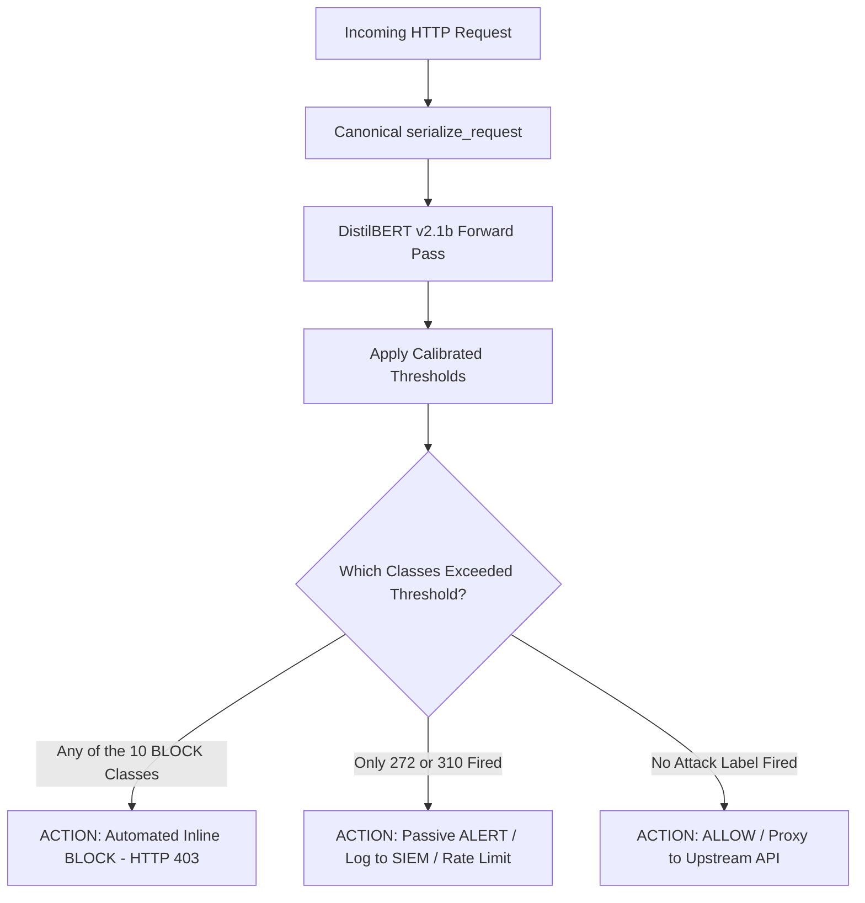

# 4thwall v3: Hardened Multi-Label Neural Web Application Firewall

A hybrid, dual-layer enterprise Web Application Firewall combining **OWASP Core Rule Set (CRS v4.23)** protocol inspection with a fine-tuned **DistilBERT Multi-Label Transformer (Model v2.1b)**. 

The production model is hosted on Hugging Face Hub at [**`viitheone/4thwall-waf-v2.1b`**](https://huggingface.co/viitheone/4thwall-waf-v2.1b) and is automatically pulled and verified at startup.

---

## 1. Dual-Layer Architecture

```
                    ┌─────────────────┐
                    │     Client      │
                    └────────┬────────┘
                             │
                       port 80 (HTTP)
                             │
                             ▼
                    ┌─────────────────┐
                    │     Nginx       │
                    │  + ModSecurity  │     Layer 1: Protocol & Header Enforcement
                    │  (OWASP CRS v4) │     - Strict inspection of headers & cookies
                    └────────┬────────┘     - Dropped at perimeter if anomaly score >= 5
                             │
                    ┌────────┴─────────┐
                    │                  │
              CRS BLOCKED           PASSED
                    │                  │
                    ▼                  ▼
             403 Forbidden    ┌─────────────────┐
             + log to         │   FastAPI API   │
             access.log       │  WAFClassifier  │   Layer 2: Semantic Transformer (v2.1b)
                              │  (DistilBERT)   │   - 13 CAPEC attack vectors
                              └────────┬────────┘   - Calibrated per-class decision thresholds
                                       │
                             ┌─────────┴─────────┐
                             │                   │
                        BLOCK TIER           ALERT TIER / ALLOW
                       (10 Vectors)          (272 / 310 / Normal)
                             │                   │
                             ▼                   ▼
                      403 Forbidden       ┌──────────────┐
                      + log to            │     DVWA     │
                      decision_log        │  (backend)   │
                                          └──────────────┘

        ┌─────────────────┐
        │  Background:    │     Tails access.log every 60s,
        │  modsec_block   │     records ModSec 403s to decision_log
        │  _logger        │     for unified dashboard visibility.
        └────────┬────────┘
                 │
                 ▼
        decision_log.json
        (BLOCK/ALERT/ALLOW + multi-label CAPEC diagnostics)
                 │
                 ▼
        ┌─────────────────┐
        │  Dashboard UI   │     port 3000
        │  (React + Vite) │
        └─────────────────┘
```

---

## 2. Model v2.1b Specifications & Benchmark Performance

Model v2.1b was trained on 363,000+ real-world requests using strict **template-disjoint grouping** to eliminate structural URI leakage, with dynamic User-Agent augmentation to prevent scanner cloaking.

- **Hugging Face Hub Repository**: [`viitheone/4thwall-waf-v2.1b`](https://huggingface.co/viitheone/4thwall-waf-v2.1b)
- **Base Architecture**: `distilbert-base-uncased` (6 transformer layers, 768 hidden dimension, 12 heads, 66M parameters)
- **Sequence Length**: `max_length = 256` tokens
- **Output Classes**: 13 multi-label categories (1 Benign + 12 CAPEC attack vectors)

### Benchmark Results (Test Unique-Template: 29,996 Novel URIs)

| Benchmark Metric | Score | Operational Significance |
|---|:---:|---|
| **Macro-F1 (Excl. 272)** | **0.9923** | Consistent semantic exploit classification across unseen paths |
| **Macro-F1 (All 13 Classes)** | **0.9830** | State-of-the-art multi-label attack discrimination |
| **Micro-F1** | **0.9912** | Overall row-level categorization accuracy |
| **Exploit Catch Rate** | **99.41%** | 22,448 / 22,582 attack rows captured |
| **Benign False Alarm Rate (Clean)** | **0.782%** | Only 58 false alerts across 7,414 unseen benign templates |
| **Production Benign Block Rate** | **0.737%** | Under 0.74% automated drops on test row-weighted traffic |
| **Dual-WAF Union Catch Rate** | **99.57%** | Synergy between OWASP CRS header inspection and ML body/query inspection |

---

## 3. Two-Tier Operational Enforcement Policy

In `4thwall_v3`, decisions are governed by a calibrated two-tier enforcement policy rather than flat binary thresholds:



### 1. BLOCK Tier (10 Automated Blocking Classes $\rightarrow$ HTTP 403)
Immediate automated drop for code execution and data breach vectors:
1. `242 - Code Injection` (XSS, PHP code execution)
2. `88 - OS Command Injection` (Shell commands, includes merged CAPEC-248)
3. `126 - Path Traversal` (Directory traversal, `/etc/passwd` inclusion)
4. `66 - SQL Injection` (SQL syntax manipulation, blind injection)
5. `16 - Dictionary-based Password Attack` (Credential stuffing signatures)
6. `153 - Input Data Manipulation` (Data tampering, sanitization evasion)
7. `274 - HTTP Verb Tampering` (Unauthorized HTTP verbs: `TRACK`, `DEBUG`, `PUT`)
8. `194 - Fake the Source of Data` (Header spoofing, SSRF proxy injection)
9. `34 - HTTP Response Splitting` (CRLF injection, header splitting)
10. `33 - HTTP Request Smuggling` (TE/CL desynchronization attacks)

### 2. ALERT Tier (2 Passive Alerting Classes)
Passed to upstream with security alert logged:
1. `272 - Protocol Manipulation` (Calibrated $T=0.99$ to neutralize crawler false alarm bursts)
2. `310 - Scanning for Vulnerable Software` (Reconnaissance tools like `sqlmap`, `nikto`)

---

## 4. Calibrated Decision Thresholds (`thresholds.json`)

Do **not** use default $T=0.50$ thresholds. Using $0.50$ produces false alarms on traffic bursts. The following validation-calibrated thresholds are enforced at runtime:

| Index | CAPEC Class Name | Threshold ($T_j$) | Enforcement Tier | Operational Rationale |
|:---:|---|:---:|:---:|---|
| 0 | `000 - Normal` | **0.55** | Baseline | Neutral benign traffic gate |
| 1 | `272 - Protocol Manipulation` | **0.99** | **ALERT** | Collapses 36,109 false alarms on headerless crawler bursts |
| 2 | `242 - Code Injection` | **0.65** | **BLOCK** | Captures XSS and PHP execution exploits |
| 3 | `88 - OS Command Injection` | **0.90** | **BLOCK** | Strict shell execution defense |
| 4 | `126 - Path Traversal` | **0.90** | **BLOCK** | Eliminates benign path lookalike drops |
| 5 | `66 - SQL Injection` | **0.70** | **BLOCK** | 99.2% recall with 0.996 precision |
| 6 | `16 - Dictionary-based Password Attack` | **0.60** | **BLOCK** | Brute-force credential stuffing defense |
| 7 | `310 - Scanning for Vulnerable Software` | **0.55** | **ALERT** | Reconnaissance detection |
| 8 | `153 - Input Data Manipulation` | **0.65** | **BLOCK** | Parameter tampering detection |
| 9 | `274 - HTTP Verb Tampering` | **0.90** | **BLOCK** | Unauthorized HTTP method rejection |
| 10 | `194 - Fake the Source of Data` | **0.90** | **BLOCK** | Header spoofing and SSRF proxy defense |
| 11 | `34 - HTTP Response Splitting` | **0.60** | **BLOCK** | CRLF injection defense |
| 12 | `33 - HTTP Request Smuggling` | **0.95** | **BLOCK** | 100% precision on desync payloads |

---

## 5. Input Serialization Protocol

Requests are converted into structured markup tokens before tokenization:
```
[METHOD] {method} [PATH] {path} [UA] {user_agent} [CT] {content_type} [BODY] {body}
```
1. **User-Agent Fallback**: Empty or missing User-Agents automatically default to `Mozilla/5.0...`. Omitting this causes the model to flag traffic as `310 - Vulnerability Scanning`.
2. **Body Truncation**: Bodies are truncated to 500 characters to prevent DistilBERT token starvation of path and query segments.
3. **Transport Encoding**: Parameters remain transport-encoded (`/?id=1%27%20OR%201=1`).

---

## 6. Quick Start

### Prerequisites
- Docker & Docker Compose
- Python 3.10+ (for local development or testing)

### 1. Copy Environment Configuration
```bash
copy .env.example .env
```
Default `.env` settings:
```env
MODEL_PATH=viitheone/4thwall-waf-v2.1b
TORCH_THREADS=4
DVWA_URL=http://dvwa:80
```

### 2. Build and Start the Stack
```bash
docker compose up --build -d
```
On startup, the API downloads the weights from [HuggingFace Hub](https://huggingface.co/viitheone/4thwall-waf-v2.1b) (~265MB) and caches them in the `hf_cache` Docker volume.

### 3. Service Access Matrix
| Service | URL | Role |
|---|---|---|
| **Nginx WAF Proxy** | `http://localhost:80` | Production entry point (OWASP CRS + Inline ML) |
| **React Dashboard** | `http://localhost:3000` | Real-time traffic monitoring & attack analytics |
| **API Healthcheck** | `http://localhost:8000/health` | Model status, F1 metrics, device info |

---

## 7. API Reference

### `POST /inspect` (Structured Component Scoring)
```bash
curl -X POST "http://localhost:8000/inspect" \
  -H "Content-Type: application/json" \
  -d '{
    "method": "POST",
    "path": "/login.php",
    "user_agent": "Mozilla/5.0",
    "content_type": "application/x-www-form-urlencoded",
    "body": "username=admin%27+OR+1%3D1--"
  }'
```
**Response**:
```json
{
  "score": 0.9981,
  "label": "malicious",
  "confidence": 0.9981,
  "decision": "BLOCK",
  "is_attack": true,
  "firing_labels": ["66 - SQL Injection"],
  "blocking_labels": ["66 - SQL Injection"],
  "alert_labels": [],
  "primary_attack": "66 - SQL Injection",
  "serialized_text": "[METHOD] POST [PATH] /login.php [UA] Mozilla/5.0 [CT] application/x-www-form-urlencoded [BODY] username=admin%27+OR+1%3D1--",
  "probabilities": {
    "000 - Normal": 0.0008,
    "66 - SQL Injection": 0.9981,
    "242 - Code Injection": 0.0012,
    "126 - Path Traversal": 0.0004
  }
}
```

### `POST /score` (Serialized String Scoring)
```bash
curl -X POST "http://localhost:8000/score" \
  -H "Content-Type: application/json" \
  -d '{"request_text": "[METHOD] GET [PATH] /?id=1%27%20OR%201=1-- [UA] Mozilla/5.0"}'
```

### `POST /score_batch` (High-Throughput Batch Scoring)
Scores an array of serialized strings in a single batched tensor operation.

---

## 8. Local Model vs Hugging Face Hub

You can toggle between the Hugging Face Hub version and local frozen checkpoints via `MODEL_PATH`:

1. **Hugging Face Hub (Default)**:
   ```env
   MODEL_PATH=viitheone/4thwall-waf-v2.1b
   ```
2. **Local Hugging Face Directory**:
   ```env
   MODEL_PATH=models/huggingface_model
   ```
3. **Local Frozen Checkpoint**:
   ```env
   MODEL_PATH=models/v2_1b
   ```

---

## 9. Verification & Automated Testing

Execute the automated test suite:
```bash
python -m pytest tests/test_model_v2_1b.py -v
```
Verifies:
- Serialization and header normalization
- Two-tier policy logic (10 BLOCK vectors, 2 ALERT vectors, benign ALLOW)
- Local model inference (`models/huggingface_model`)
- Hugging Face Hub inference (`viitheone/4thwall-waf-v2.1b`)
- FastAPI endpoints (`/health`, `/score`, `/inspect`, `/dashboard`)
